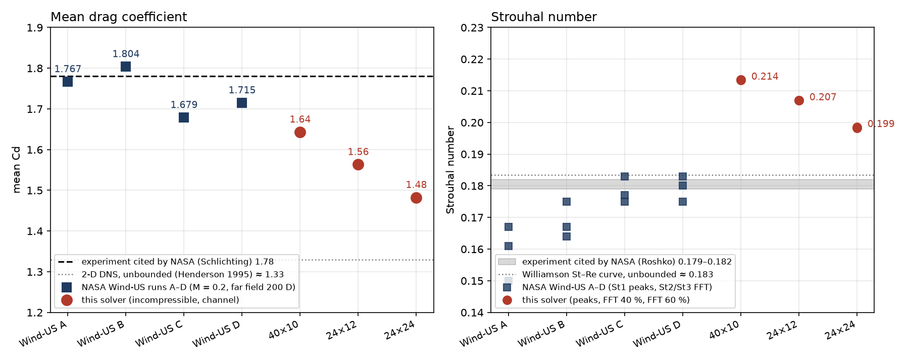
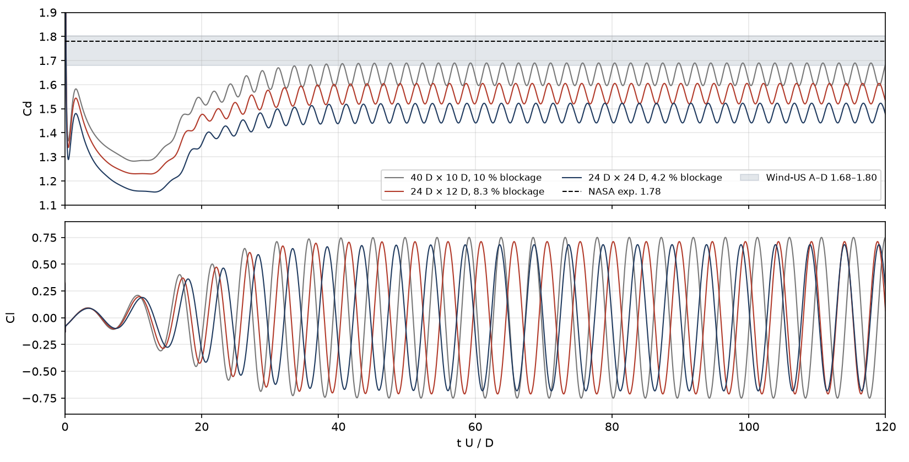
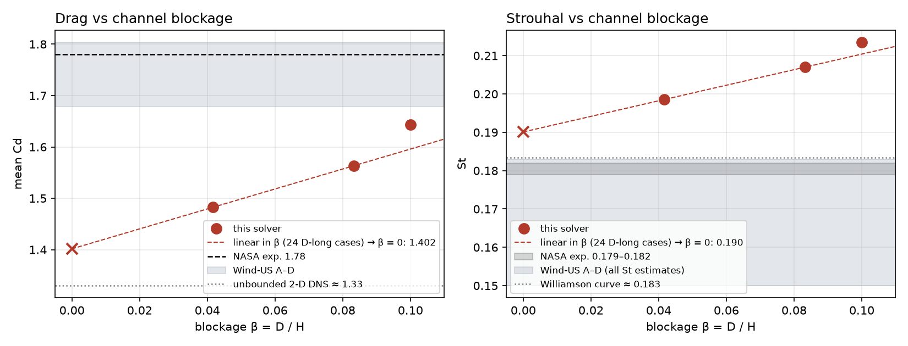

# Comparison with NASA GRC Wind-US Study #1 (laminar cylinder, Re = 150)

Reference: NASA Glenn, *Laminar Flow over a Circular Cylinder: Study #1*,
<https://www.grc.nasa.gov/www/wind/valid/lamcyl/Study1_files/Study1.html>.

Figures and numbers below are produced by `tools/compare_nasa.py` from the
`fields_*.npz` histories of `ns_staggered_euler.py` (`--fine`, `--scheme central`,
run to tU/D = 120, Cd/Cl averaged over the last 40 %).

## What NASA computed and what we compute

| | NASA Study #1 (Wind-US) | this solver |
|---|---|---|
| equations | compressible Navier–Stokes, M = 0.2 | incompressible Navier–Stokes |
| domain | C-grid, far field 200 D (effectively unbounded) | channel with no-slip walls: 40 D × 10 D (β = 10 %), 24 D × 12 D (β = 8.3 %), 24 D × 24 D (β = 4.2 %) |
| grid | 401 × 201 structured, wall spacing 1.0e-3 D | O–H multiblock, 26k–47k cells, wall cell 0.015 D, far field 0.12 D |
| time | implicit, 1st/2nd order, Δt ≈ 0.02 D/U∞ (≈ 270 steps per period), with/without Global Newton | explicit Euler, Δt ≈ 0.0045 D/U∞ (≈ 1000 steps per period) |
| convection | 2nd-order HLLE | 2nd-order central (face average) |
| St estimate | St1: mean spacing of the last four peaks; St2/St3: FFT of a probe signal | same two methods applied to Cl(t) (FFT over the last 40 % and 60 %) |
| experimental targets | Cd = 1.78 (Schlichting), St = 0.179–0.182 (Roshko) | same targets |

## Results

| case | cells | mean Cd | Cd osc. (±) | Cl amp. | St (peaks) | St (FFT) | Cd_p / Cd_v at t = 120 |
|---|---|---|---|---|---|---|---|
| NASA exp. (Schlichting / Roshko) | — | **1.78** | — | — | **0.179–0.182** | | |
| Wind-US A (1st order) | 401×201 | 1.767 | | | 0.161 | 0.150 / 0.167 | |
| Wind-US B (2nd order) | 401×201 | 1.804 | | | 0.164 | 0.175 / 0.167 | |
| Wind-US C (1st order + Newton) | 401×201 | 1.679 | | | 0.177 | 0.175 / 0.183 | |
| Wind-US D (2nd order + Newton) | 401×201 | 1.715 | | | 0.180 | 0.175 / 0.183 | |
| this solver, 40 D × 10 D (β = 10 %) | 37,044 | 1.643 | 0.047 | 0.751 | 0.213 | 0.214 | 1.35 / 0.34 |
| this solver, 24 D × 12 D (β = 8.3 %) | 26,444 | 1.563 | 0.043 | 0.712 | 0.207 | 0.207 | 1.21 / 0.32 |
| this solver, 24 D × 24 D (β = 4.2 %) | 46,644 | 1.483 | 0.041 | 0.683 | 0.198 | 0.199 | 1.17 / 0.31 |
| this solver, extrapolated to β = 0 (linear in β, 24 D-long cases) | — | 1.40 | | | | 0.190 | |
| unbounded 2-D incompressible references | — | ≈ 1.33 (Henderson 1995 DNS) | | ≈ 0.5 | | 0.183 (Williamson St–Re curve) | |







## Reading the comparison

**Strouhal number.** On the 24 D × 12 D channel we get St = 0.207, 14 % above
the experimental band (0.179–0.182) that NASA uses as target, and above every
Wind-US run (0.150–0.183). Most of the excess is wall confinement: St falls to
0.198 when the channel is doubled in height and extrapolates to 0.190 at zero
blockage, i.e. +5 % against the experiment and +4 % against Williamson's
unbounded value 0.183. Peak-spacing and FFT estimates agree to 3 decimals, so
the number is not a measurement artefact. The remaining 4–5 % is the far-field
resolution (0.12 D cells carrying the vortices downstream) and, to a lesser
extent, the outlet 18 D behind the cylinder.

**Mean drag.** Here the picture is the opposite of NASA's. Wind-US reproduces
the experimental 1.78 within ±3 % (1.68–1.80); we are 12 % low on the 24 D × 12 D
channel (1.56) and, because confinement *raises* drag, lower still as the
channel widens (1.48 at β = 4.2 %, 1.40 extrapolated). The target itself is the
reason: 1.78 is read from Schlichting's experimental Cd–Re curve, which at
Re ≈ 150 contains three-dimensional and end effects and considerable scatter.
Two-dimensional incompressible DNS of the same problem (Henderson 1995 and
later studies) gives Cd ≈ 1.33, and our β → 0 value of 1.40 is within ≈ 5 % of
that. In other words, against the 2-D incompressible problem we actually solve,
drag agrees to about 5 %; against NASA's experimental target it does not, and
no 2-D incompressible solution should be expected to.

**Drag split.** Pressure drag is 78–80 % of the total (1.17–1.35), viscous drag
0.31–0.34, consistent with the ≈ 0.3 viscous contribution usually reported at
Re = 150. The drag oscillates at twice the lift frequency with amplitude
≈ ±0.04, as on NASA's Figure 5.

**Lift amplitude.** 0.68–0.75 against ≈ 0.5 for unbounded 2-D DNS; blockage and
the coarse far field both inflate it. NASA does not report a lift amplitude.

**Time scheme.** NASA's runs show that first-order time marching lowers St
(A: 0.161 vs D: 0.180) at ≈ 270 steps per period. Our explicit Euler is also
first order but takes ≈ 1000 steps per period because the stability limit of
the explicit scheme is far below the accuracy limit, so the temporal error is
small; the trends above are governed by the domain and the far-field mesh, not
by the time integration.

## Summary

| quantity | NASA target | this solver (24 D × 12 D) | this solver (β → 0) | verdict |
|---|---|---|---|---|
| St | 0.179–0.182 | 0.207 (+14 %) | 0.190 (+5 %) | blockage explains 2/3 of the gap; remainder is far-field resolution |
| Cd | 1.78 | 1.56 (−12 %) | 1.40 (−21 %) | NASA's target is an experimental (3-D) value; against 2-D DNS (≈ 1.33) we are within 5 % |
| Cd oscillation | 2 × lift frequency | 2 × lift frequency, ±0.04 | — | agrees |

To close the remaining gaps within this code: widen the channel to ≥ 30 D
(β ≤ 3 %), refine the far field (d_max ≈ 0.06), and move the outlet to
≥ 25 D downstream.

## Reproduce

```bash
cd cylinder_re150
python ns_staggered_euler.py --fine --scheme central --t-end 120 --frame-every 100 --out-dir output_ns/fine_24x12
python - <<'EOF'
from mesh_from_known_sizes import INPUT, main
I = dict(INPUT); I.update(dict(y_max=24.0, yc=12.0, d_min=0.015, d_max=0.12, growth_ratio=1.15, max_jump=2.0, a=None))
main(I, tag="tall24")
EOF
python ns_staggered_euler.py --mesh mesh_output/staggered_tall24.npz --scheme central --t-end 120 --steps 200000 --frame-every 100 --no-gif --out-dir output_ns/tall24
python tools/compare_nasa.py
```
